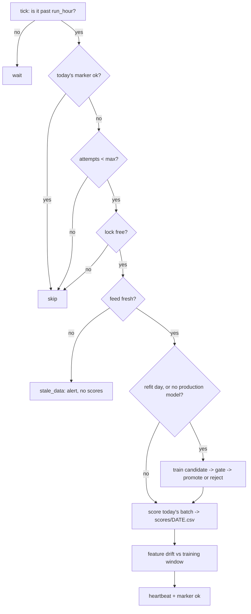

# Scheduled model runner

A model in a registry earns nothing until something runs it every day. `src/mlcycle/scheduler.py` is that
something for the churn model: a daily scoring job with a weekly refit, built so that it is safe to leave alone.

## What it guards against

| Failure | Guard |
|---|---|
| The job runs twice (a retry, a double trigger) | Idempotent run markers: a day that ended `ok` is not run again unless forced; scores are written atomically |
| Two runs overlap | A lock file taken with `O_EXCL`; a lock older than `lock_timeout_minutes` is broken with an alert |
| The data feed did not update | Freshness check before anything else; older than `max_feed_age_hours` -> fail closed, no scores, alert |
| A crash mid-run | The run is marked `failed`, an alert is sent, and the next tick retries, up to `max_attempts` per day |
| The job silently stops running | Heartbeat file plus `health_check`, called by something outside the job |
| A refit makes things worse | Every candidate goes through the registry gate against production; a rejected candidate is logged, not promoted |
| Training on labels that did not exist yet | The feed only exposes periods whose labels have arrived (`label_lag`) |
| The alert channel is down | Alerts always go to `alerts.jsonl` first; a failing sink is logged and never fails the run |

## One daily run



## State on disk

```
<state>/
    run.lock             present only while a run is in progress
    heartbeat.json       last successful run: time, date, model version
    alerts.jsonl         every alert, one JSON line each
    runs/<date>.json     one marker per day: status, attempts, feed age, refit result, rows scored
    scores/<date>.csv    customer_id, churn_probability, model_version
    registry/            the model registry (see registry-and-promotion.md)
```

Statuses: `ok`, `stale_data`, `no_model`, `failed`, and `locked` (returned, not written).

## Configuration

`RunnerConfig` holds the schedule and the thresholds:

| Field | Default | Meaning |
|---|---|---|
| `run_hour` | 6 | The daily run fires at the first tick at or after this hour |
| `refit_weekday` | 6 (Sunday) | Weekly refit day |
| `max_feed_age_hours` | 30 | A daily feed plus a grace period; older is stale |
| `heartbeat_max_age_hours` | 26 | One day plus slack; older means the job is not running |
| `lock_timeout_minutes` | 60 | Longer than any normal run |
| `max_attempts` | 3 | Tries per day before giving up and leaving it to a person |
| `train_periods` | 4 | Labelled periods in the refit window; the newest one is the gate holdout |
| `drift_psi_alert` | 0.2 | PSI above this on any feature raises a warning |

Alert sinks are plain callables that take the alert dict. `webhook_sink(url)` posts JSON; the CLI adds it only when
`MLCYCLE_ALERT_WEBHOOK` is set, so no URL lives in code.

## Time is injected

Nothing reads the wall clock directly. The runner asks a `Clock`, so `SimulatedClock` can replay six weeks in a
few seconds, and the result is the same on every run and every machine. The replay plants three events: a feed
outage, one scoring crash, and the drift already built into the data.

```bash
python -m mlcycle.cli schedule simulate --days 42 --state /tmp/runner
```

On my machine the 42-day replay gave 45 runs: 41 days scored, 3 `stale_data` attempts on the one day the feed was
more than 30 hours old (the first outage day was still inside the grace period), and 1 `failed` attempt that the
next hourly tick retried successfully. Seven refits: the bootstrap and one later candidate were promoted, five were
rejected by the gate. The outside health check failed once, at noon on the stale day. These are synthetic data and
show the mechanics, not model quality.

## Running it for real

- **Trigger.** cron, a systemd timer, Windows Task Scheduler or a Kubernetes CronJob calls
  `python -m mlcycle.cli schedule run-once` every hour or so. Because runs are idempotent, extra triggers are
  harmless; the hourly cadence is what gives you retries.
- **Feed.** Replace `SyntheticFeed` with your own class with the same four methods: `last_updated`, `batch`,
  `labelled`, `period`. `last_updated` must report when the source last changed, not when you last asked it.
- **Health.** Run `python -m mlcycle.cli schedule health` from a different machine or a monitoring service. Exit
  code 1 means unhealthy. A job cannot report that it never started; only an outside check can.
- **Exit codes.** `run-once` exits 0 on `ok` (or an already-done day), 2 on stale data, 3 on anything else, so the
  scheduler's own failure view is meaningful.
- **Retries vs alerts.** Each failed attempt raises an alert. If that is too noisy for your channel, filter in the
  sink (for example only forward the attempt that reaches `max_attempts`).

## Limits

- The lock is a file, so it protects one machine or one shared filesystem, not a fleet. Use a database row or a
  lease in your scheduler for that.
- Stale data fails closed. If a late score is worse than no score for your use, that is right; if not, add a
  "score with a STALE flag" mode deliberately rather than by accident.
- The refit uses a fixed window. For other choices see [retraining-policies.md](retraining-policies.md).
